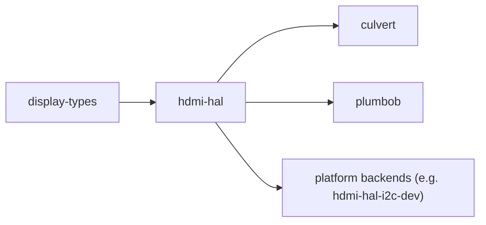

# hdmi-hal

[](https://github.com/DracoWhitefire/hdmi-hal/actions/workflows/ci.yml)
[](https://crates.io/crates/hdmi-hal)
[](https://docs.rs/hdmi-hal)
[](LICENSE)
[](https://blog.rust-lang.org/2025/02/20/Rust-1.85.0.html)
[](https://slsa.dev)
[](#verifying-releases)

> **Part of [Ashlar](https://ashlar-display.org)** — a display connection stack in Rust,
> HDMI 2.1 first: from EDID parsing through mode negotiation to FRL link training.
>
> [display-types](https://github.com/DracoWhitefire/display-types) ·
> [piaf](https://github.com/DracoWhitefire/piaf) ·
> [concordance](https://github.com/DracoWhitefire/concordance) ·
> [cartouche](https://github.com/DracoWhitefire/cartouche) ·
> [culvert](https://github.com/DracoWhitefire/culvert) ·
> [plumbob](https://github.com/DracoWhitefire/plumbob) ·
> **hdmi-hal** ·
> [hdmi-hal-i2c-dev](https://github.com/DracoWhitefire/hdmi-hal-i2c-dev)

Hardware abstraction traits for the HDMI stack.

`hdmi-hal` defines the behavioral contracts between protocol logic and hardware. It is a
traits-only crate: no implementations live here. Every trait expresses an I/O boundary
that multiple crates in the stack need to cross in a compatible way — raw SCDC register
access over DDC/I²C, and HDMI 2.1 transmitter PHY control (what FRL link training needs:
rate, training patterns, output mode, scrambling and TxFFE levels). Further PHY
configuration is on the [roadmap](doc/roadmap.md).

## Usage
```sh
cargo add hdmi-hal
```

Implement a trait against your hardware backend:

```rust
use hdmi_hal::scdc::ScdcTransport;

struct MyI2cBackend { /* ... */ }

impl ScdcTransport for MyI2cBackend {
    type Error = MyError;

    fn read(&self, reg: u8) -> Result<u8, MyError> { /* ... */ }
    fn write(&mut self, reg: u8, value: u8) -> Result<(), MyError> { /* ... */ }

    // One DDC transaction for the whole buffer. A backend that cannot burst-read
    // implements this with `hdmi_hal::scdc::read_block_bytewise(self, reg, buf)` and
    // says so: its reads are then one register at a time.
    fn read_block(&self, reg: u8, buf: &mut [u8]) -> Result<(), MyError> { /* ... */ }
}
```

Accept a trait bound in consumer code:

```rust
use hdmi_hal::scdc::ScdcTransport;

fn configure_frl<T: ScdcTransport>(transport: &mut T) -> Result<(), T::Error> {
    transport.write(0x31, 0x01)?; // initiate FRL
    Ok(())
}
```

For a complete worked example of both traits with a simulated backend, see
[`examples/simulate`](examples/simulate/).

## Stack position

`hdmi-hal` sits between the platform backends and the protocol logic crates. It has no
dependency on the rest of the stack; protocol crates depend on it, not the reverse.



Async variants of both traits live in the companion crate `hdmi-hal-async`, following
the same split as `embedded-hal` / `embedded-hal-async`.

## Out of scope

- **Protocol logic** — SCDC register semantics, typed register wrappers, and the FRL
  link training state machine belong in the crates that consume `ScdcTransport`.
- **Implementations** — concrete platform backends (kernel I²C drivers, simulator
  harnesses, test doubles) live in the crates that use these traits.
- **PHY vendor backends** — hardware-specific register sequences belong in platform
  crates that implement `HdmiPhy`.
- **CEC or eARC protocol logic** — only the wire-access primitive will belong here;
  protocol state machines are in their own crates.

## Documentation

- [`doc/architecture.md`](doc/architecture.md) — trait surfaces, design principles, async story, and stack position
- [`doc/roadmap.md`](doc/roadmap.md) — planned features and future work

## Verifying releases

Releases are built on GitHub Actions and attested with
[SLSA Build Level 2](https://slsa.dev) provenance (from 0.4.0). To verify a release
`.crate` against its signed provenance, install the
[GitHub CLI](https://cli.github.com/) and run:

```sh
gh attestation verify hdmi-hal-X.Y.Z.crate --repo DracoWhitefire/hdmi-hal
```

The attested `.crate` is attached to each
[GitHub release](https://github.com/DracoWhitefire/hdmi-hal/releases).

Releases after 0.4.1 are uploaded through crates.io
[trusted publishing](https://rust-lang.github.io/rfcs/3691-trusted-publishing-cratesio.html): the publish
workflow obtains a short-lived token via OpenID Connect instead of using a stored
API token. crates.io can also reject uploads made with an API token for this crate;
the badge above shows whether that setting is on. Each version's publishing details,
including the workflow run and commit, are available from the crates.io API:

```sh
curl -A "your-tool (contact)" https://crates.io/api/v1/crates/hdmi-hal/X.Y.Z
# see .version.trustpub_data
```

Versions up to 0.3.0 were uploaded with an API token (0.1.0 by hand, 0.2.0 and 0.3.0
from CI) and carry no provenance; 0.4.0 and 0.4.1 carry provenance but were also
uploaded with an API token.

## License

Licensed under the [Mozilla Public License 2.0](LICENSE).
